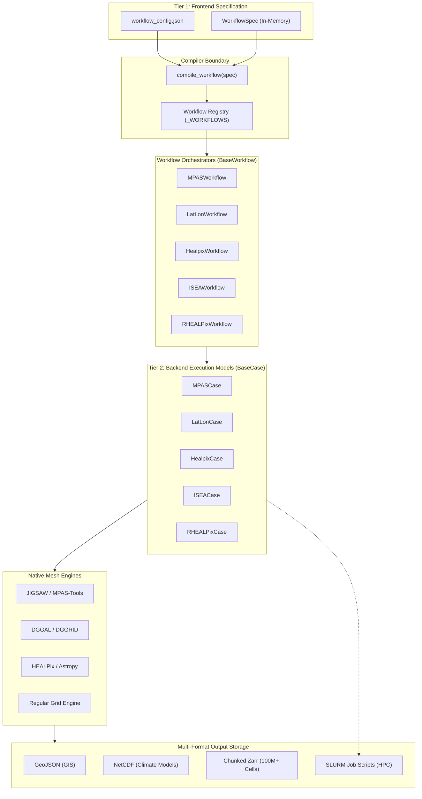

# PyEarthMesh Architecture Reference

`pyearthmesh` (v0.1.0) is a lightweight, high-performance mesh generation and spatial modeling package for Earth science applications, developed by Dr. Chang Liao (Pacific Northwest National Laboratory / E3SM project).

It is a member of the **PyEarthSuite** ecosystem, providing comprehensive capabilities for regular grids, discrete global grid systems (DGGS), and unstructured Voronoi/Delaunay meshes.

---

## 1. Architectural Philosophy & Design Principles

PyEarthMesh is built around four core design principles:

1. **Two-Tier Compiler Architecture (Frontend vs. Backend Separation)**:
   - **Tier 1 (Frontend Intent)**: Users express mesh requirements in intuitive, mesh-agnostic scientific terms (domain boundary, target cell sizes in km, feature refinement flags) via a single JSON file (`workflow_config.json`) or a `WorkflowSpec` object.
   - **Compiler Boundary**: The [`compile_workflow()`](../../pyearthmesh/config/config_manager.py) engine lowers high-level intent into the specific parameter vocabulary, units, and flags required by low-level mesh generators.
   - **Tier 2 (Backend Execution)**: Mesh-native Case adapters (`MPASCase`, `LatLonCase`, etc.) orchestrate directory preparation, binary execution, and output handling.

2. **Mesh Family Modularity**:
   - Distinct mesh families are encapsulated in dedicated subpackages:
     - **Structured Grids**: `latlon`, `square`, `hexagon`, `triangular`
     - **Spherical DGGS**: `healpix`, `rhealpix`, `isea`, `dggrid`
     - **Unstructured Meshes**: `mpas`, `tin`, `jigsaw`
   - Generators can run standalone or be driven through the unified workflow layer.

3. **In-Memory Transformation Pipeline**:
   - Eliminates intermediate flat configuration files. Configuration flows in memory from JSON $\rightarrow$ `WorkflowSpec` $\rightarrow$ compiled dictionary $\rightarrow$ Case object.

4. **Multi-Scale and High-Resolution Storage**:
   - Meshes scale from regional watersheds to global domains with 100M+ cells.
   - Storage formats range from GIS-standard GeoJSON/Parquet to NetCDF (for climate models) and chunked, compressed Zarr (for massive DGGS/Voronoi meshes).

---

## 2. High-Level System Architecture



---

## 3. Subsystem Breakdown Down to Module & Class Level

### 3.1 `pyearthmesh.config` & `pyearthmesh.config.workflows`
Configuration management, compiler boundary, and workflow lifecycle orchestration.

| Module / Class | Key Functions & Responsibilities | Description |
| :--- | :--- | :--- |
| [`config_manager.py`](../../pyearthmesh/config/config_manager.py) | `load_workflow_config(path)`<br>`compile_workflow(spec_or_path)`<br>`create_workflow(config_or_path)`<br>`register_workflow(type, cls)` | Single entry point for configuration loading, two-tier compiler lowerings, and workflow factory instantiation. |
| [`WorkflowSpec`](../../pyearthmesh/config/workflows/base.py) | `from_dict(data)`<br>`to_dict()` | Frontend contract defining mesh-agnostic fields: `mesh_type`, `case_index`, `date`, `region`, `resolution`, `paths`, `execution`, `features`. |
| [`BaseWorkflow`](../../pyearthmesh/config/workflows/base.py) | `validate()`<br>`compile_frontend_to_backend()`<br>`build_case()`<br>`setup()`<br>`run()`<br>`create_hpc_job()` | Abstract workflow base class orchestrating validation, translation, case construction, and execution. |
| [`MPASWorkflow`](../../pyearthmesh/config/workflows/mpas_workflow.py) | `translate_frontend_to_backend()`<br>`build_case()` | Compiles generic resolutions (ocean, land, river, coastline) to JIGSAW sizing parameters and instantiates `MPASCase`. |
| [`LatLonWorkflow`](../../pyearthmesh/config/workflows/latlon_workflow.py) | `translate_frontend_to_backend()`<br>`build_case()` | Computes row/column extents and bounds from bounding box and grid resolution in degrees. |
| [`HealpixWorkflow`](../../pyearthmesh/config/workflows/healpix_workflow.py) | `translate_frontend_to_backend()`<br>`build_case()` | Translates meter resolution to `nside` power-of-two level and pixel nesting. |
| [`ISEAWorkflow`](../../pyearthmesh/config/workflows/isea_workflow.py) | `translate_frontend_to_backend()`<br>`build_case()` | Maps meter resolution and aperture modes (ISEA3H, ISEA4H) to DGGAL/DGGRID parameters. |
| [`RHEALPixWorkflow`](../../pyearthmesh/config/workflows/rhealpix_workflow.py) | `translate_frontend_to_backend()`<br>`build_case()` | Configures rHEALPix DGGS planar projections and hierarchical tiling. |

---

### 3.2 `pyearthmesh.classes`
Data structures, base case adapters, and native backend configuration registries.

| Module / Class | Key Attributes & Methods | Description |
| :--- | :--- | :--- |
| [`base_case.py`](../../pyearthmesh/classes/base_case.py) (`BaseCase`) | `setup()`<br>`run()`<br>`create_hpc_job()` | Foundation class for all mesh generation cases; standardizes lifecycle execution across engines. |
| [`mpas.py`](../../pyearthmesh/classes/mpas.py) / [`mpascase.py`](../../pyearthmesh/meshes/unstructured/mpas/mpascase.py) (`MPASCase`) | `setup()`<br>`run()`<br>`create_hpc_job(slurm, hours)` | Manages JIGSAW workspace setup (`tmp/`, `out/`), executes `create_mpas_mesh()`, and writes SLURM job scripts. |
| [`meshcell.py`](../../pyearthmesh/classes/meshcell.py) (`pymeshcell`) | `lCellID`, `dLongitudeCenter`, `dLatitudeCenter`, `aVertex`, `aEdge`, `aNeighbor` | Core topological mesh cell primitive supporting Voronoi, hexagonal, triangular, and square geometries. |
| [`vertex.py`](../../pyearthmesh/classes/vertex.py) / [`edge.py`](../../pyearthmesh/classes/edge.py) | `pyvertex`, `pyedge` | Geometric primitives tracking vertex coordinates, edge lengths, and shared neighbor relationships. |
| [`meshconfig.py`](../../pyearthmesh/classes/meshconfig.py) (`ConfigManager`) | `get_default_config(type)`<br>`validate_config(config)` | Backend registry holding native parameter classes: `MPASConfig`, `LatLonConfig`, `HealpixConfig`, `ISEAConfig`, `JigsawConfig`. |

---

### 3.3 `pyearthmesh.meshes`
Mesh generation algorithms grouped by geometric family.

#### Structured & DGGS Meshes (`pyearthmesh.meshes.structured`)
- **LatLon** (`structured/latlon`): Regular geographic longitude/latitude grids with pole and antimeridian handling.
- **Hexagon** (`structured/hexagon`): Projected regular hexagonal grids with aperture alignment.
- **Square** (`structured/square`): Projected Cartesian grids.
- **Triangular** (`structured/triangular`): Regular triangular tessellations.
- **HEALPix & rHEALPix** (`structured/dggs/healpix`): Hierarchical Equal Area isoLatitude Pixelization on the sphere.
- **ISEA & DGGRID** (`structured/dggs/isea`, `dggs/dggrid`): Icosahedral Snyder Equal Area hexagonal discrete global grid systems.

#### Unstructured Meshes (`pyearthmesh.meshes.unstructured`)
- **MPAS** (`unstructured/mpas`): Centroidal Voronoi tessellations for global climate and regional earth system models.
- **JIGSAW** (`unstructured/jigsaw`): Interface to the JIGSAW Delaunay triangulation engine and sizing grid generators.
- **TIN** (`unstructured/tin`): Triangular Irregular Networks for complex terrain and bathymetry.

---

### 3.4 `pyearthmesh.utility`
I/O utilities, format converters, and spatial conditioning tools.

| Module / File | Key Functions | Description |
| :--- | :--- | :--- |
| [`zarr_io.py`](../../pyearthmesh/utility/zarr_io.py) | `ZarrMeshWriter`<br>`ZarrMeshReader`<br>`write_mesh_to_zarr()`<br>`read_mesh_from_zarr()` | Chunked, compressed Zarr storage engine for handling meshes with 100M+ cells. |
| [`zarr_config.py`](../../pyearthmesh/utility/zarr_config.py) | `get_compression_profile()`<br>`get_chunk_size_recommendation()` | Compression profiles (`lz4`, `zstd`) and ragged-array neighbor encoding configurations. |
| [`convert_mesh_formats.py`](../../pyearthmesh/utility/convert_mesh_formats.py) | `convert_vector_to_zarr()`<br>`convert_zarr_to_vector()` | Transcoding between GDAL vector files (GPKG, GeoJSON, Shapefile) and chunked Zarr. |
| [`create_coastline_buffer.py`](../../pyearthmesh/utility/create_coastline_buffer.py) | `create_coastline_buffer()` | Generates simplified, dissolved coastal buffer polygons with `iFlag_simplify_in=1`. |
| [`convert_coordinates.py`](../../pyearthmesh/utility/convert_coordinates.py) | `convert_coordinates()` | Geographic (lon/lat) to Cartesian ($x, y, z$) 3D sphere coordinate projections. |

---

## 4. Execution Workflow Lifecycle

The standard execution lifecycle flows through 4 distinct phases:

```text
1. Load & Resolve Paths      load_workflow_config("workflow_config.json")
           │
           ▼
2. Compile Spec              compile_workflow(spec)
           │                 └── Translates units (km -> degrees), maps keys, applies defaults
           ▼
3. Construct Case            create_workflow(config) -> builds Workflow & Case in-memory
           │
           ▼
4. Execute or Submit         workflow.setup() -> workflow.run() [or create_hpc_job()]
```

This decoupled lifecycle ensures that user configuration scripts remain stable even as underlying computational mesh backends evolve.
