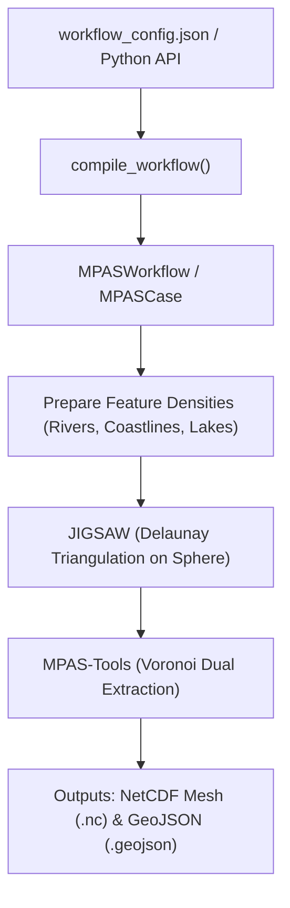

# Generating MPAS Meshes with PyEarthMesh

This user manual walks through generating Model for Prediction Across Scales (MPAS) meshes using **PyEarthMesh**. 

PyEarthMesh provides a modern, configuration-driven two-tier architecture that automates mesh sizing, feature conditioning (rivers, coastlines, lakes), JIGSAW execution, and Voronoi dual-mesh generation.

---

## 1. Overview of MPAS Mesh Generation

An **MPAS mesh** is a spherical centroidal Voronoi tessellation (SCVT) where grid cells are mostly hexagons with occasional pentagons and heptagons. Variable-resolution meshes allow fine spatial resolution over areas of interest (e.g., river basins or coastlines) while smoothly transitioning to coarser resolution over open oceans.

### Generation Pipeline



---

## 2. Prerequisites & Environment Setup

MPAS mesh generation requires both Python libraries and underlying native tools (`jigsaw` and `mpas-tools`).

### Recommended Conda Environment

```bash
# Create and activate conda environment
conda create -n earthmesh python=3.12 -c conda-forge
conda activate earthmesh

# Install spatial and mesh dependencies
conda install -c conda-forge \
    gdal \
    jigsaw \
    jigsawpy \
    mpas-tools \
    netcdf4 \
    shapely \
    cartopy

# Install PyEarthSuite packages
pip install pyearth pyearthmesh
```

---

## 3. Method 1: Modern Configuration-Driven Workflow (Recommended)

The recommended way to generate an MPAS mesh is using a single, human-readable JSON configuration file (`workflow_config.json`).

### Step 1: Create `workflow_config.json`

Create a file named `workflow_config.json` specifying your domain, resolutions, and feature inputs:

```json
{
  "workflow": {
    "mesh_type": "mpas",
    "case_index": 1,
    "model": "jigsaw",
    "debug": true,
    "run_on_hpc": false
  },
  "resolutions": {
    "ocean_km": 100.0,
    "land_km": 50.0,
    "river_network_km": 5.0,
    "coastline_km": 10.0,
    "lake_boundary_km": 5.0,
    "watershed_boundary_km": 5.0
  },
  "paths": {
    "region_geometry": "data/region.geojson",
    "output_workspace": "./output/mpas_run",
    "river_network_raster": "data/river_networks.tif",
    "lake_boundary_vector": "data/lake_boundary.geojson",
    "coastline_raster": "data/coastline_mask.tif"
  },
  "jigsaw": {
    "standalone": true,
    "create_directory": true,
    "hours": 3,
    "slurm": "slurm",
    "ncolumn_space": 3600,
    "nrow_space": 1800,
    "iFlag_geom": true,
    "iFlag_spac": true,
    "iFlag_spac_ocean": true,
    "iFlag_spac_land": true,
    "iFlag_geom_river_network": true,
    "iFlag_spac_river_network": true,
    "iFlag_geom_lake_boundary": true,
    "iFlag_spac_lake_boundary": true,
    "iFlag_spac_coastline": true
  }
}
```

### Configuration Sections Explained

- **`workflow`**:
  - `mesh_type`: Always `"mpas"` for MPAS meshes.
  - `case_index`: Numeric identifier for tracking experiment cases.
  - `model`: Mesh generator backend (defaults to `"jigsaw"`).
  - `run_on_hpc`: Set to `true` to generate SLURM job submission scripts instead of running locally.
- **`resolutions`**:
  - Cell spacing in **kilometres**.
  - Sizing functions smoothly blend between `ocean_km`, `land_km`, and feature resolutions like `river_network_km`.
- **`paths`**:
  - `region_geometry`: GeoJSON file defining the study domain boundary (or empty for global).
  - `output_workspace`: Directory where outputs, logs, and intermediate meshes are saved.
  - Feature files (`river_network_raster`, `lake_boundary_vector`, etc.).
- **`jigsaw`**:
  - Fine-grained control flags for JIGSAW sizing and geometry constraints.
  - Sizing grid resolution (`ncolumn_space`, `nrow_space`).

---

### Step 2: Run Mesh Generation with Python

Write a minimal Python runner script (e.g. `run_mesh.py`):

```python
from pathlib import Path
from pyearthmesh.config.config_manager import create_workflow

def main():
    # 1. Load configuration and initialize workflow
    config_path = Path("workflow_config.json")
    workflow = create_workflow(config_path)

    print(f"Output directory: {workflow.output_workspace}")
    print(f"Mesh target file: {workflow.mesh_file}")

    # 2. Check execution mode (Local vs. HPC)
    if workflow.workflow.get("run_on_hpc"):
        print("Generating HPC SLURM submission scripts...")
        workflow.create_hpc_job()
        print("Submit your job with: sbatch " + str(Path(workflow.output_workspace) / "submit.job"))
    else:
        # 3. Local execution: prepare workspace and generate mesh
        print("Setting up workspace...")
        workflow.setup()

        print("Running MPAS mesh generation...")
        cells = workflow.run()

        if cells is not None:
            print(f"Success! Created MPAS mesh with {len(cells):,} cells.")
            print(f"Saved to: {workflow.mesh_file}")

if __name__ == "__main__":
    main()
```

Run the script:

```bash
python run_mesh.py
```

---

## 4. Method 2: Programmatic In-Memory Compilation

If you want to generate meshes dynamically without saving a JSON file first, you can compile configuration dictionaries in Python directly:

```python
from pyearthmesh.config.config_manager import create_workflow

spec = {
    "workflow": {
        "mesh_type": "mpas",
        "case_index": 1,
        "debug": True,
        "run_on_hpc": False
    },
    "resolutions": {
        "ocean_km": 120.0,
        "land_km": 45.0,
        "coastline_km": 15.0
    },
    "paths": {
        "output_workspace": "./output/mpas_quick",
        "region_geometry": "boundary.geojson"
    },
    "features": {
        "coastline": True
    }
}

# Create, set up, and execute the workflow
workflow = create_workflow(spec)
workflow.setup()
cells = workflow.run()
```

---

## 5. Method 3: Low-Level Case Class (`MPASCase`)

For advanced scripting or custom pipeline integration, you can directly instantiate [`MPASCase`](../pyearthmesh/meshes/unstructured/mpas/mpascase.py):

```python
from pyearthmesh.meshes.unstructured.mpas.mpascase import MPASCase

config = {
    "mesh_type": "mpas",
    "iCase_index": 1,
    "sWorkspace_output": "./output/direct_case",
    "dResolution_ocean": 100.0,
    "dResolution_land": 50.0,
    "dSpac_value": 100.0,
    "iFlag_run_jigsaw": 1,
    "iFlag_global": 1,
}

case = MPASCase(config)
case.setup()
cells = case.run()
```

---

## 6. Output Files and Directory Structure

After execution completes, your `output_workspace` directory will contain:

```text
output/mpas_run/
├── mpas.geojson                 # GeoJSON polygon mesh of Voronoi cells
├── mpas_mesh.nc                 # Standard MPAS NetCDF mesh (used in E3SM / MPAS)
├── mpas_mesh_triangles.nc       # Intermediate Delaunay triangular mesh
├── jigsaw/                      # Intermediate JIGSAW files (sizing functions, .msh)
│   ├── tmp/
│   └── out/
├── run_mpas.py                  # HPC driver script (if generated)
└── submit.job                   # SLURM submission script (if generated)
```

### Inspecting Output in Python

```python
import geopandas as gpd

# Load the generated GeoJSON mesh
gdf = gpd.read_file("output/mpas_run/mpas.geojson")
print(f"Total cells: {len(gdf)}")
print(gdf.head())

# Quick visual check
gdf.boundary.plot()
```

---

## 7. HPC / SLURM Execution

For high-resolution regional or global meshes, mesh generation can take significant CPU memory and runtime. 

Set `"run_on_hpc": true` in `workflow_config.json`:

```json
"workflow": {
  "mesh_type": "mpas",
  "run_on_hpc": true
},
"jigsaw": {
  "hours": 8,
  "slurm": "slurm_partition_name"
}
```

Running `workflow.create_hpc_job()` will generate:
1. `run_mpas.py`: Standalone Python driver with environment paths configured.
2. `submit.job`: Ready-to-submit SLURM batch file.

Submit the job:
```bash
cd output/mpas_run
sbatch submit.job
```

---

## 8. Exporting to Chunked Zarr Storage

For very large meshes (10M+ to 100M+ cells), you can convert the output vector mesh to chunked Zarr format:

```python
from pyearthmesh.utility.convert_mesh_formats import convert_vector_to_zarr

convert_vector_to_zarr(
    input_file="output/mpas_run/mpas.geojson",
    zarr_path="output/mpas_run/mpas_mesh.zarr",
    mesh_type="mpas",
    chunk_size=500000,
    compression_profile="balanced"
)
```
